# Manual de usuario: Sistema de Seguimiento de Proyectos Gráficos

Este manual explica, paso a paso y con capturas de pantalla, cómo usar la plataforma. Tiene una
parte común (crear la cuenta, entrar, moverse por la aplicación), una parte para el **docente** y
otra para el **estudiante**. Al final hay preguntas frecuentes y una guía de los mensajes de error.

> **Sobre las imágenes.** Las capturas se tomaron el 28 de octubre de 2026, con la versión publicada
> ese día (rediseño de la calificación final), y con datos de ejemplo: las personas, cursos y
> trabajos que aparecen son ficticios. Tres son del 20 de octubre porque muestran acciones que solo
> se hacen una vez: crear el curso, unirse a él y subir una versión. Esas pantallas no cambiaron.
> Los **recuadros rojos numerados** señalan los elementos que explica el texto que sigue a cada
> imagen.

**¿Cómo entrar?** Abre en el navegador la dirección que te compartió tu institución. En el
despliegue actual del proyecto es
<https://frontend.yellowsand-87b574b4.westus.azurecontainerapps.io>.

## Índice

1. [Antes de empezar](#1-antes-de-empezar)
2. [Acceso a la plataforma (docentes y estudiantes)](#2-acceso-a-la-plataforma-docentes-y-estudiantes)
3. [Manual del docente](#3-manual-del-docente)
4. [Manual del estudiante](#4-manual-del-estudiante)
5. [Preguntas frecuentes](#5-preguntas-frecuentes)
6. [Mensajes del sistema y qué hacer](#6-mensajes-del-sistema-y-qué-hacer)
7. [Resumen: lo que se puede y lo que no se puede deshacer](#7-resumen-lo-que-se-puede-y-lo-que-no-se-puede-deshacer)

---

## 1. Antes de empezar

### 1.1 Qué es la plataforma

En los cursos de diseño gráfico, un proyecto avanza por **iteraciones**: el estudiante entrega una
versión, el docente la comenta, el estudiante corrige y entrega otra. La plataforma guarda ese
proceso completo en un solo lugar:

- Cada **versión** queda registrada con su archivo, su descripción y su fecha, y no se puede
  modificar ni borrar.
- El docente deja **retroalimentación** sobre cada versión, con una nota parcial opcional.
- Al terminar, el docente asigna la **calificación final**.
- Docente y estudiante pueden **exportar el portafolio en PDF**.

### 1.2 Quién hace qué

| Rol | Qué puede hacer |
|---|---|
| **Docente** | Crear cursos y compartir su código. Crear proyectos individuales o por grupos. Editar, ocultar y eliminar proyectos. Ver las versiones de sus estudiantes, comentarlas y calificarlas. Asignar la calificación final. Ver el progreso del curso. Exportar el portafolio de cualquier estudiante de sus cursos |
| **Estudiante** | Unirse a cursos con un código. Formar grupos o unirse a uno. Subir versiones. Ver la retroalimentación y su progreso. Exportar el portafolio de un proyecto y armar su portafolio académico |

El rol se elige al crear la cuenta y **no se puede cambiar después**.

### 1.3 Qué necesitas

- Un navegador actualizado: Chrome, Edge, Firefox o Safari, en computador o celular.
- Tu correo institucional.
- Para los estudiantes: el **código del curso** que comparte el docente, y los trabajos en formato
  **JPG, PNG, PDF o SVG** de máximo **20 MB** cada uno.

### 1.4 Palabras que vas a encontrar

| Término | Qué significa |
|---|---|
| **Curso** | Espacio que crea un docente, por ejemplo «Diseño Gráfico III». Tiene un código de 6 caracteres para que los estudiantes se unan |
| **Código del curso** | Seis letras o números, como `NZDKDC`. No importa si se escribe en mayúsculas o minúsculas |
| **Proyecto** | Un encargo dentro de un curso, con título y descripción. Es **individual** o **por grupos** |
| **Grupo** | Estudiantes del curso que trabajan juntos en un proyecto por grupos. Los forman los propios estudiantes, dentro del plazo que fija el docente |
| **Versión** | Una entrega: un archivo y una descripción de qué cambió. Se numeran v1, v2, v3… |
| **Historial** | Todas las versiones de un estudiante (o de un grupo) en un proyecto, de la más reciente a la más antigua |
| **Retroalimentación** | Comentario del docente sobre una versión. Puede llevar una calificación parcial de 0 a 5 |
| **Calificación parcial vigente** | La nota más reciente de una versión. Si el docente pone otra, la anterior queda **reemplazada** (tachada), pero no se borra |
| **Calificación final** | La nota de cierre del proyecto. Se asigna una sola vez y no se cambia |
| **Progreso** | Porcentaje de versiones que ya recibieron al menos un comentario del docente |
| **Proyecto oculto** | Proyecto que el docente retiró de la vista de los estudiantes, o que dejó como borrador. No se pierde nada |
| **Portafolio** | Documento PDF con las versiones, los comentarios y las notas. Puede ser de un proyecto o, para el estudiante, de varios cursos a la vez (portafolio académico) |

---

## 2. Acceso a la plataforma (docentes y estudiantes)

### 2.1 Crear una cuenta

1. En la pantalla de inicio de sesión, haz clic en **Crear cuenta**.
2. Completa el formulario:

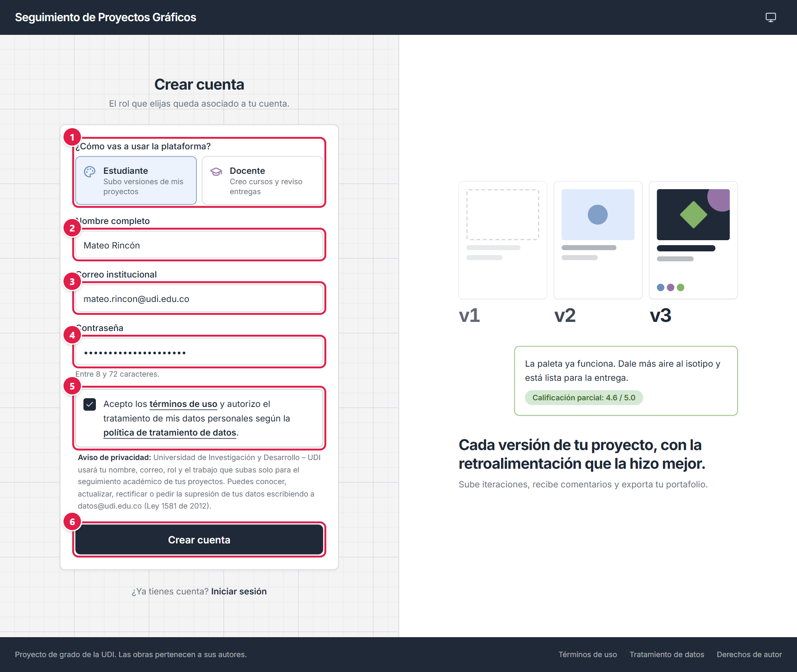

| # | Elemento | Qué hacer |
|---|---|---|
| 1 | **¿Cómo vas a usar la plataforma?** | Elige **Estudiante** (subes versiones) o **Docente** (creas cursos y revisas entregas). La tarjeta elegida queda resaltada. **Este rol no se puede cambiar después** |
| 2 | **Nombre completo** | Tu nombre como quieres que lo vean tus compañeros y docentes (de 2 a 100 caracteres) |
| 3 | **Correo institucional** | Será tu usuario para entrar. No se puede registrar dos veces el mismo correo |
| 4 | **Contraseña** | Entre 8 y 72 caracteres. Las tildes y la ñ ocupan más espacio, así que una contraseña muy larga con tildes puede no caber |
| 5 | **Términos y datos personales** | Marca la casilla para aceptar los términos de uso y autorizar el tratamiento de tus datos. Puedes leer cada documento en su enlace. Sin esta autorización no se puede crear la cuenta |
| 6 | **Crear cuenta** | Crea la cuenta y **entra automáticamente**: no tienes que iniciar sesión otra vez |

Si falta algo, cada campo muestra en rojo lo que hay que corregir:

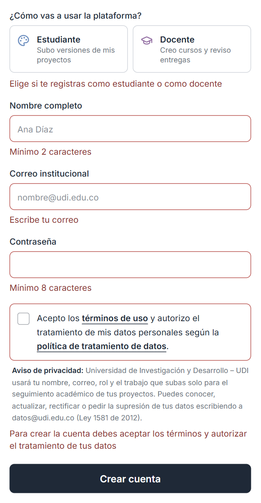

### 2.2 Iniciar sesión

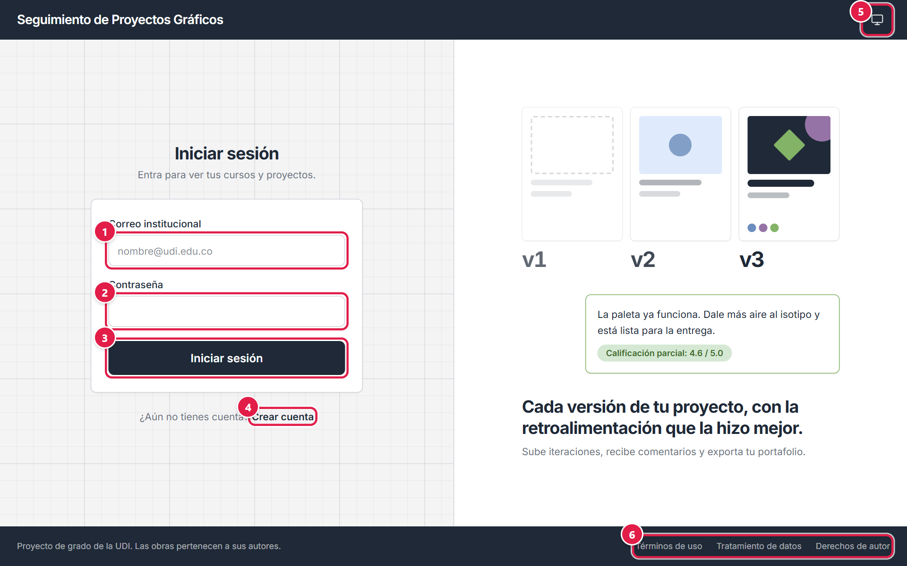

| # | Elemento | Para qué sirve |
|---|---|---|
| 1 | **Correo institucional** | El correo con el que creaste la cuenta |
| 2 | **Contraseña** | Tu contraseña |
| 3 | **Iniciar sesión** | Entra a la plataforma. Si el correo o la contraseña no coinciden, verás «Credenciales inválidas» |
| 4 | **Crear cuenta** | Lleva al registro (sección 2.1) |
| 5 | **Tema** | Cambia entre tema del sistema, claro y oscuro (sección 2.4) |
| 6 | **Documentos legales** | Términos de uso, tratamiento de datos y derechos de autor. Se pueden leer sin tener cuenta |

> La primera vez que se abre la plataforma después de un rato sin uso, el servidor puede tardar
> entre 15 y 30 segundos en responder. Si ves «No se pudo conectar con el servidor», espera unos
> segundos e intenta de nuevo.

### 2.3 Cómo está organizada la pantalla

Después de entrar verás tu página de **Inicio**. La estructura es la misma para los dos roles:

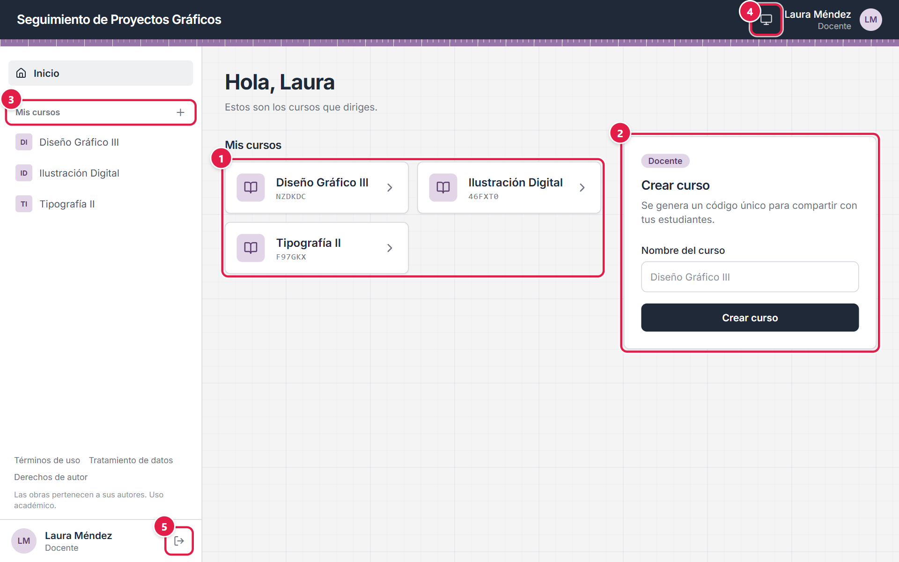

- **Barra superior:** el nombre de la plataforma (un clic te lleva al Inicio), el botón de tema y
  tu nombre con tu rol. La franja de color debajo indica el rol: **morada** para docentes y
  **azul** para estudiantes.
- **Barra lateral (izquierda):**
  - **Inicio**, y para los estudiantes, **Mi portafolio**.
  - **Mis cursos** (3), con el botón **+** para crear un curso (docente) o unirse a uno
    (estudiante). Al abrir un curso, debajo aparecen sus proyectos.
  - Al pie: los documentos legales, tu nombre y el botón **Cerrar sesión** (5).
- **Contenido (centro):** la página que estás viendo. En el Inicio, tus cursos (1) y el formulario
  para crear un curso o unirte a uno (2).

### 2.4 Tema claro y oscuro

El botón de la barra superior (4 en la imagen anterior) recorre tres opciones: **Sistema** (sigue
la configuración de tu computador o celular), **Claro** y **Oscuro**. El ícono muestra la opción
actual. La preferencia se guarda en ese navegador.

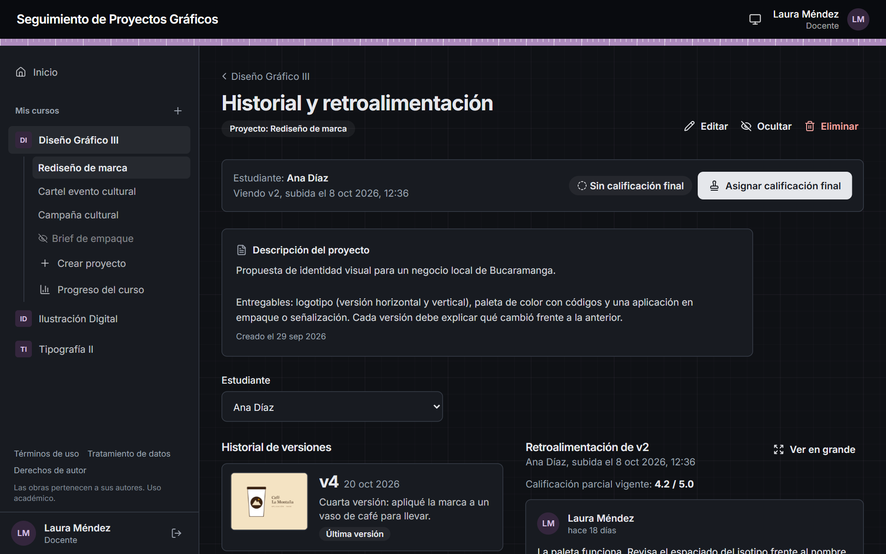

### 2.5 Uso desde el celular

La plataforma se adapta a pantallas pequeñas. La barra lateral se abre con el botón **☰** de la
esquina superior izquierda (o tocando el círculo con tus iniciales), y se cierra con la **X** o al elegir una página.

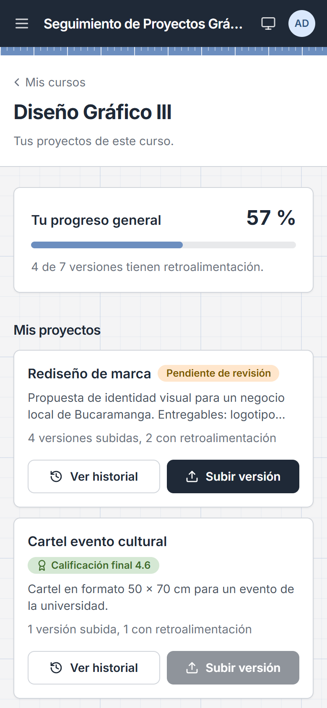
&nbsp;&nbsp;
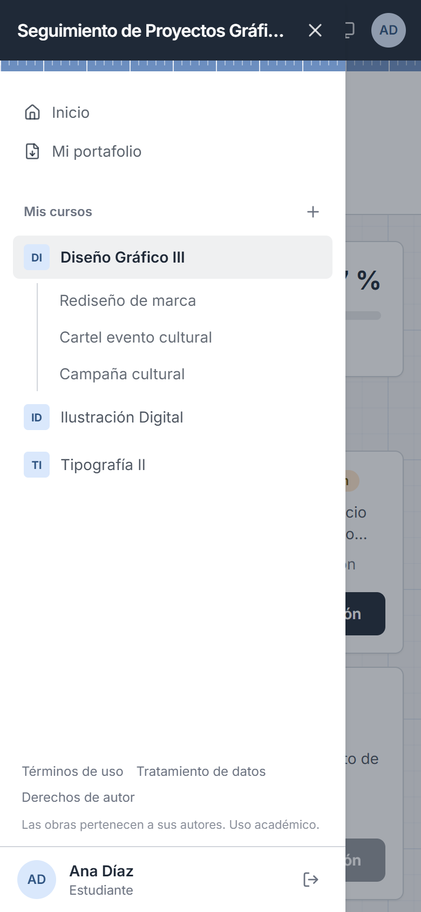

### 2.6 Cerrar sesión y sesión vencida

- Para salir, usa el botón **Cerrar sesión** al pie de la barra lateral. Hazlo siempre en
  computadores compartidos.
- Por seguridad, la sesión dura **60 minutos**. Cuando vence, la plataforma te lleva a la pantalla
  de inicio de sesión. Al volver a entrar, regresas a la página donde estabas. Lo que no hayas
  guardado (un comentario a medio escribir, por ejemplo) se pierde, así que guarda con frecuencia.
- Si al abrir la plataforma aparece «No se pudo conectar con el servidor» con el botón
  **Reintentar**, tu sesión sigue guardada: revisa tu conexión y haz clic en **Reintentar**.

---

## 3. Manual del docente

### 3.1 El recorrido completo

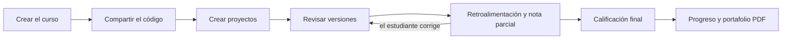

### 3.2 Crear un curso

1. En **Inicio**, busca la tarjeta **Crear curso** (a la derecha).
2. Escribe el **Nombre del curso**, por ejemplo «Ilustración Digital».
3. Haz clic en **Crear curso**.

La plataforma abre el curso nuevo y muestra un aviso con el **código** que debes compartir:

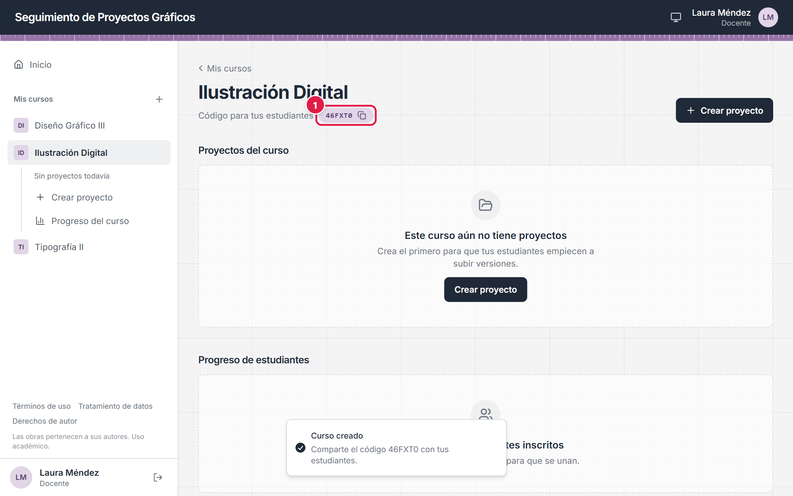

El código (1) siempre está visible en la parte superior del curso. **Haz clic sobre él para
copiarlo** y pegarlo en un correo, en el aula virtual o en el chat del curso. Cada curso tiene un
código distinto que genera el sistema.

### 3.3 El panel del curso

Al abrir un curso desde **Mis cursos** verás su panel:

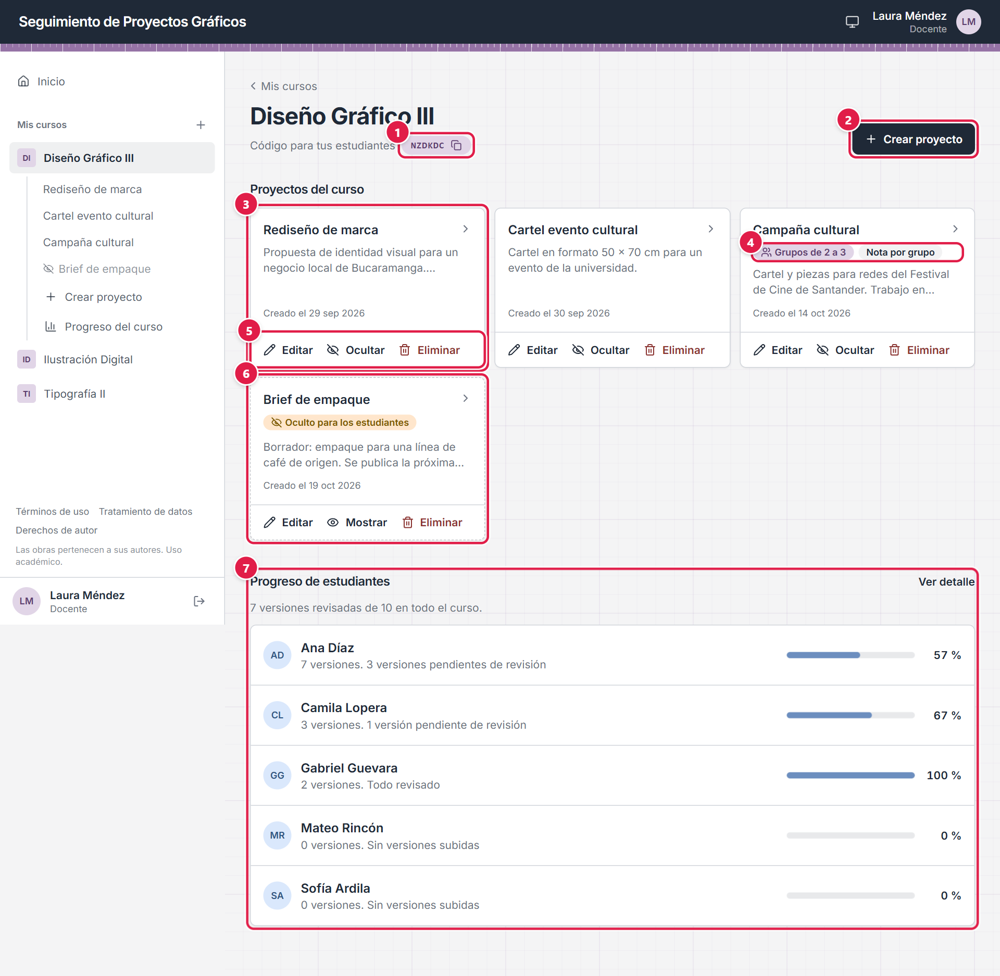

| # | Elemento | Para qué sirve |
|---|---|---|
| 1 | **Código para tus estudiantes** | Clic para copiarlo |
| 2 | **Crear proyecto** | Abre el formulario de proyecto (secciones 3.4 y 3.5) |
| 3 | **Tarjeta de proyecto** | Título, descripción y fecha de creación. Clic en la tarjeta para abrir su historial de versiones |
| 4 | **Etiquetas de grupos** | En los proyectos por grupos: el tamaño de los grupos y si la nota es individual o por grupo |
| 5 | **Editar · Ocultar · Eliminar** | Acciones sobre el proyecto (sección 3.6) |
| 6 | **Proyecto oculto** | Borde punteado y etiqueta «Oculto para los estudiantes». Ellos no lo ven. Aquí el botón dice **Mostrar** |
| 7 | **Progreso de estudiantes** | Cuántas versiones revisaste del total y el avance de cada estudiante. **Ver detalle** abre la página completa de progreso (sección 3.11) |

### 3.4 Crear un proyecto individual

1. En el panel del curso, haz clic en **Crear proyecto**.
2. Escribe el **Título** (obligatorio, hasta 150 caracteres).
3. Escribe la **Descripción** (opcional, hasta 5000 caracteres). Es el enunciado que verán los
   estudiantes: explica el objetivo y qué se espera en cada entrega.
4. En **Modalidad**, deja **Individual**.
5. Si quieres prepararlo sin que los estudiantes lo vean todavía, marca **Crear oculto
   (borrador)**.
6. Haz clic en **Crear proyecto**.

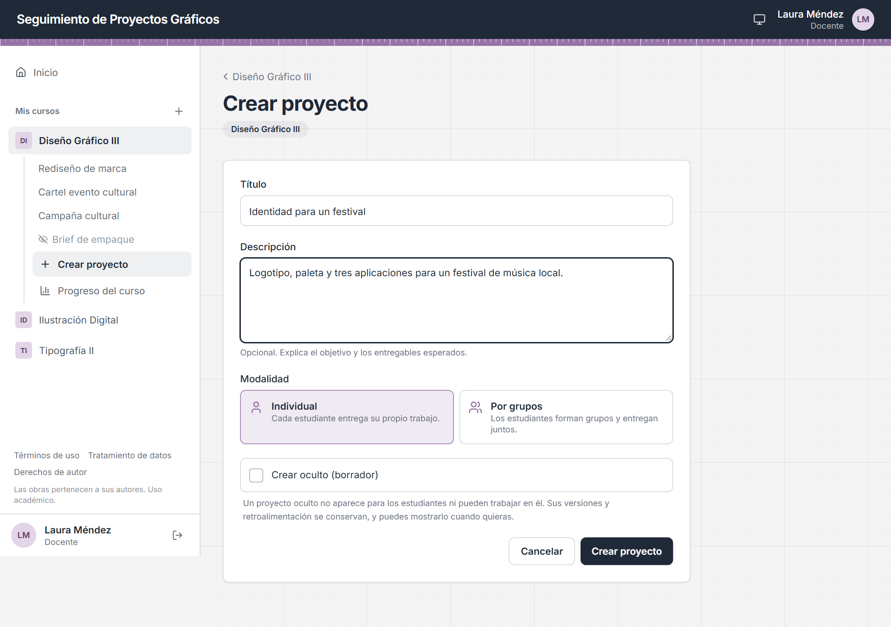

### 3.5 Crear un proyecto por grupos

Al elegir **Por grupos** en la modalidad aparecen las opciones de los grupos:

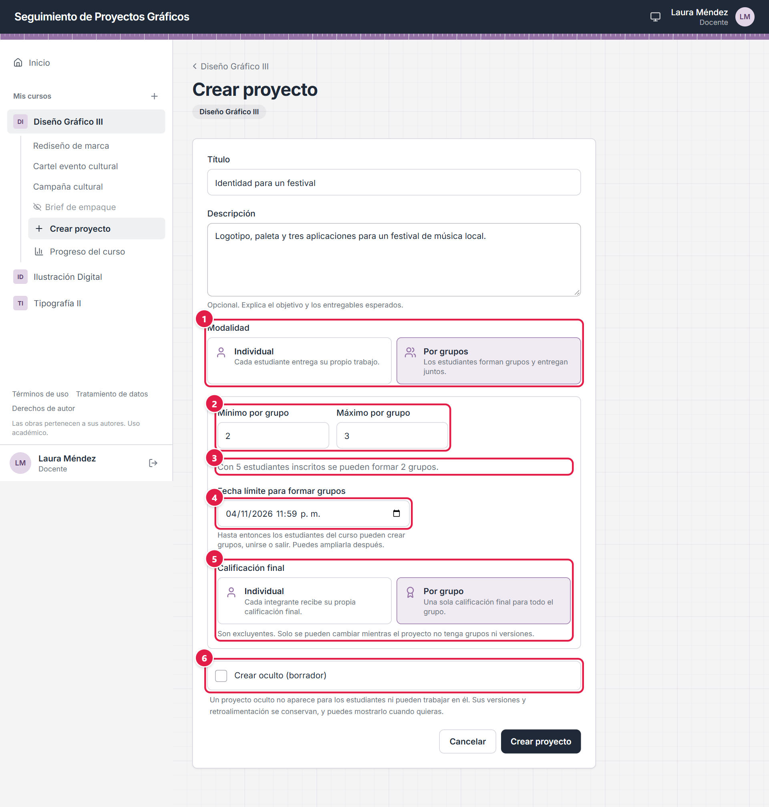

| # | Opción | Qué significa |
|---|---|---|
| 1 | **Modalidad: Por grupos** | Los estudiantes forman grupos y entregan juntos. Las versiones son del grupo y registran quién de los integrantes las subió |
| 2 | **Mínimo y máximo por grupo** | Entre 2 y 10 integrantes, y el mínimo no puede ser mayor que el máximo. El máximo es un tope: nadie puede entrar a un grupo lleno. El mínimo es una meta: si un grupo queda por debajo, verás una advertencia |
| 3 | **Aviso de formación** | Calcula si los estudiantes inscritos se pueden repartir en grupos de ese tamaño sin que nadie quede por fuera. Si no se puede, muestra una advertencia, pero igual puedes crear el proyecto: los estudiantes pueden seguir inscribiéndose |
| 4 | **Fecha límite para formar grupos** | Hasta ese momento los estudiantes pueden crear grupos, unirse o salir. Por defecto es dentro de 7 días a las 11:59 p. m. Debe ser una fecha futura. Puedes cambiarla después |
| 5 | **Calificación final** | **Individual:** cada integrante recibe su propia nota final. **Por grupo:** una sola nota para todo el grupo. Son excluyentes |
| 6 | **Crear oculto (borrador)** | Igual que en el proyecto individual |

> **Importante:** la modalidad, el tamaño de los grupos y el tipo de calificación solo se pueden
> cambiar **mientras el proyecto no tenga grupos ni versiones**. Revisa estas opciones antes de
> publicar el proyecto.

### 3.6 Editar, ocultar, mostrar o eliminar un proyecto

Estas acciones están en la tarjeta del proyecto (panel del curso) y en la parte superior de su
historial.

**Editar.** Siempre puedes cambiar el título, la descripción, la visibilidad y la fecha límite de
los grupos. Si el proyecto ya tiene grupos o versiones, la modalidad, el tamaño de los grupos y la
calificación quedan bloqueados, y el formulario te lo indica (1):

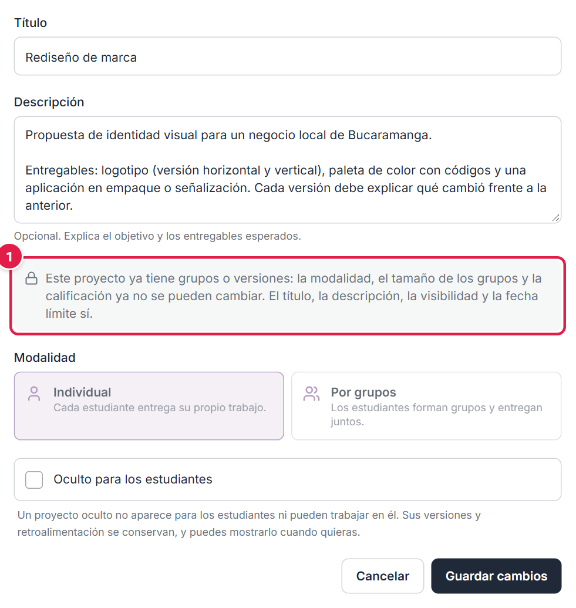

**Ocultar y mostrar.** **Ocultar** retira el proyecto de la vista de los estudiantes: no lo ven ni
pueden trabajar en él. Sus versiones y comentarios se conservan, y con **Mostrar** todo vuelve a
estar como antes. Sirve para borradores y para retirar un proyecto que ya no se usa.

**Eliminar.** Solo se puede eliminar un proyecto **sin versiones**. Se borran el proyecto y los
grupos que se hayan formado, y no se puede deshacer. Si el proyecto ya tiene entregas, la
plataforma no lo elimina, porque son evidencia académica de los estudiantes. En su lugar te ofrece
**Ocultar en su lugar**:

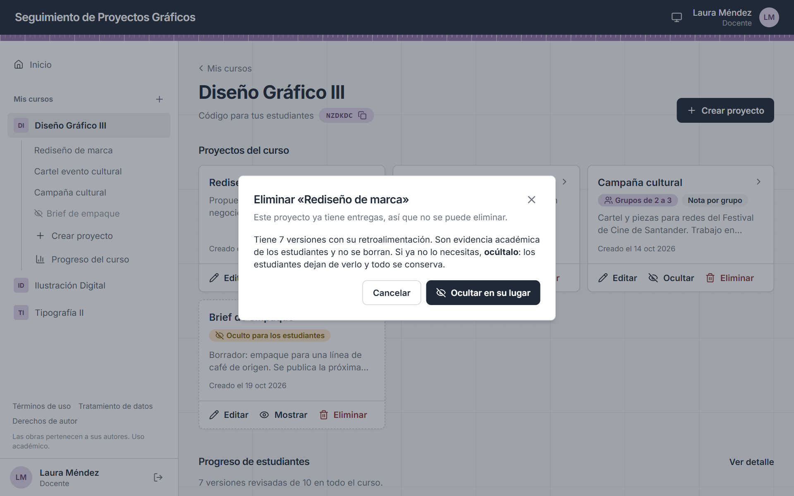

### 3.7 Revisar las versiones de un proyecto

Haz clic en un proyecto (en el panel del curso o en la barra lateral) para abrir su **Historial y
retroalimentación**:

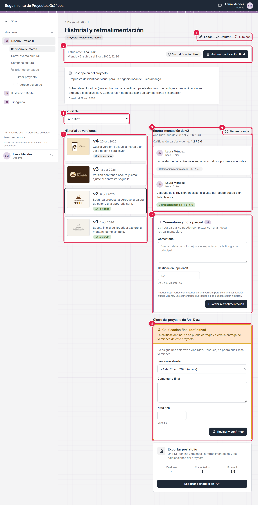

| # | Elemento | Para qué sirve |
|---|---|---|
| 1 | **Editar · Ocultar · Eliminar** | Las acciones del proyecto (sección 3.6) |
| 2 | **Barra de calificación final** | A quién estás revisando, qué versión tienes abierta y si ya tiene calificación final. Desde aquí se asigna (sección 3.9) |
| 3 | **Estudiante** | Filtra el historial de un estudiante. Con «Todos los estudiantes» se mezclan las versiones de todos, con el nombre del autor en cada una |
| 4 | **Historial de versiones** | Las versiones, de la más reciente a la más antigua, con su número, fecha, miniatura y descripción. **Última versión** marca la más reciente de cada estudiante y **Revisada**, las que ya tienen comentarios. Haz clic en una para ver su retroalimentación |
| 5 | **Retroalimentación de la versión elegida** | Todos los comentarios de esa versión, en orden, con la calificación parcial vigente arriba. Una nota reemplazada aparece tachada |
| 6 | **Ver en grande** | Abre la versión a pantalla completa |
| 7 | **Comentario y nota parcial** | El formulario para comentar la versión elegida (sección 3.8). Tiene un borde morado a la izquierda |
| 8 | **Calificación final (definitiva)** | Dentro del **Cierre del proyecto**: el formulario de la calificación final (sección 3.9), con borde y encabezado naranja. Debajo está la exportación del portafolio (sección 3.12) |

**Ver en grande.** Muestra el archivo en tamaño completo junto a la retroalimentación. Con
**Descargar original** (1) obtienes el archivo tal como lo subió el estudiante. Los PDF y SVG se ven
mejor descargados.

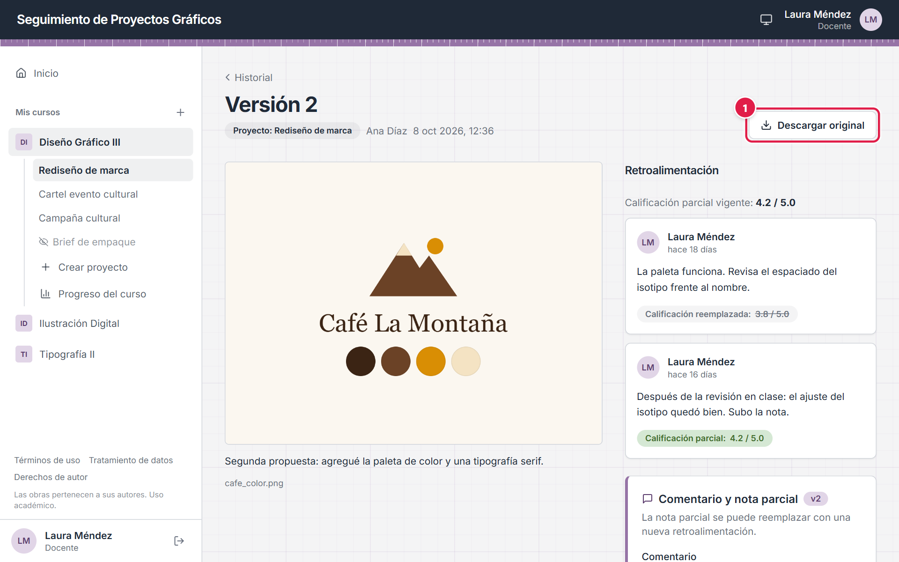

### 3.8 Dejar retroalimentación y calificación parcial

1. En el historial, haz clic en la versión que quieres comentar.
2. En **Comentario y nota parcial**, escribe el **Comentario** (obligatorio, hasta 5000
   caracteres).
3. Si quieres, escribe una **Calificación** de 0 a 5. Admite decimales, por ejemplo 4.2.
4. Haz clic en **Guardar retroalimentación**.

Reglas:

- Puedes dejar **varios comentarios** en una misma versión.
- Cada versión tiene **una sola calificación parcial vigente**. Si la versión ya tiene nota y
  escribes otra, la plataforma te avisa antes de guardar y el botón cambia a **Guardar y reemplazar
  nota**. La nota anterior no se borra: queda en el historial como **reemplazada**.
- Los comentarios guardados **no se pueden editar ni borrar**. Si te equivocaste, agrega otro
  comentario que lo aclare.
- Puedes seguir comentando aunque el estudiante ya tenga calificación final.

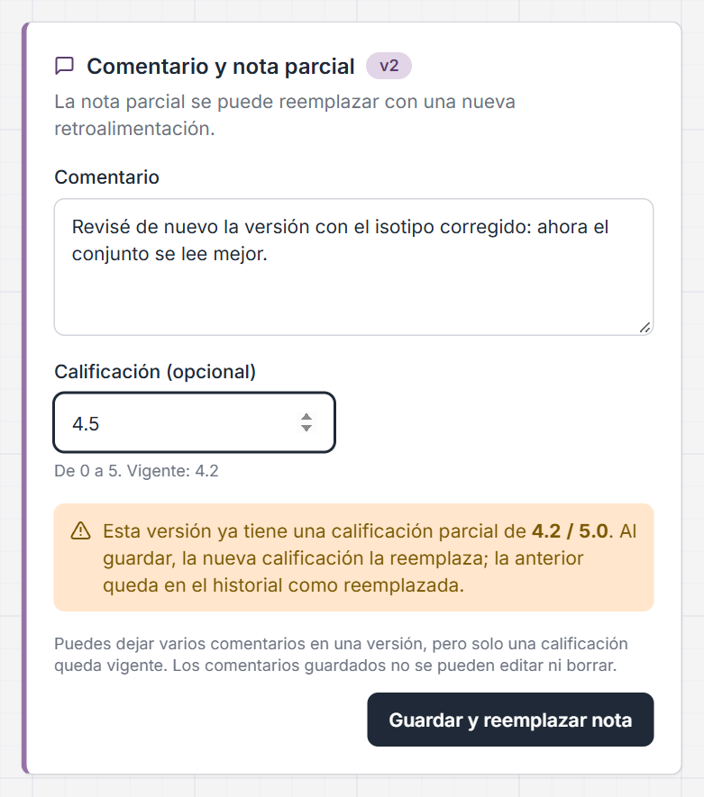

### 3.9 Asignar la calificación final

La calificación final cierra el proyecto de un estudiante (o de un grupo).

**Nota parcial y calificación final no son lo mismo.** En el historial están en dos bloques
distintos:

| | **Comentario y nota parcial** | **Calificación final (definitiva)** |
|---|---|---|
| Dónde está | Debajo de la retroalimentación de la versión | En el **Cierre del proyecto** |
| Cómo se ve | Borde morado a la izquierda | Borde y encabezado naranja |
| Cuántas | Varias por versión; una nueva reemplaza a la vigente | Una sola por estudiante (o grupo) y proyecto |
| ¿Se corrige? | Sí, con otra retroalimentación | **No** |
| Efecto | Ninguno sobre las entregas | El estudiante ya no puede subir versiones |

**Dónde ver si ya tiene calificación final.** Arriba del historial, la **barra de calificación
final** dice a quién estás revisando, qué versión tienes abierta y **Sin calificación final**, o
**Calificación final: 4,5** si ya la tiene. Está a la vista sin desplazarse, también en el celular:

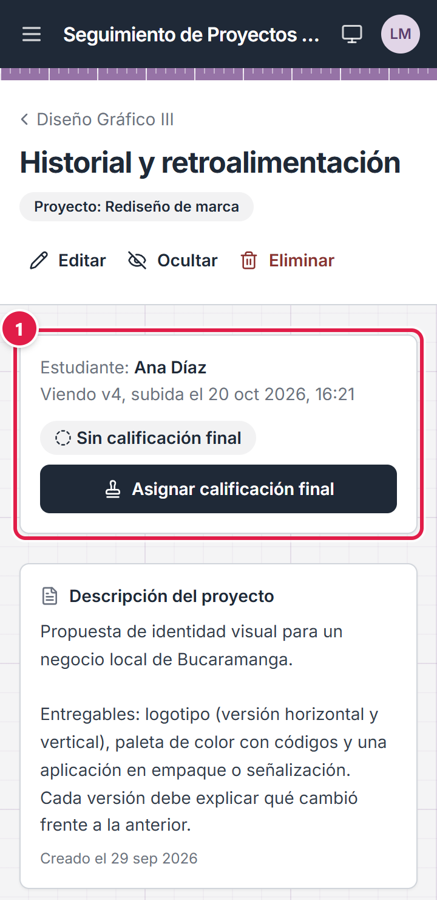

**Pasos:**

1. En el historial, elige el estudiante en el filtro **Estudiante** (o haz clic en una de sus
   versiones). La barra muestra su nombre.
2. Haz clic en **Asignar calificación final**, en la barra. Si todavía no escribiste nada, la página
   te lleva al bloque **Calificación final (definitiva)** con el cursor en el comentario.
3. Llena el bloque:

   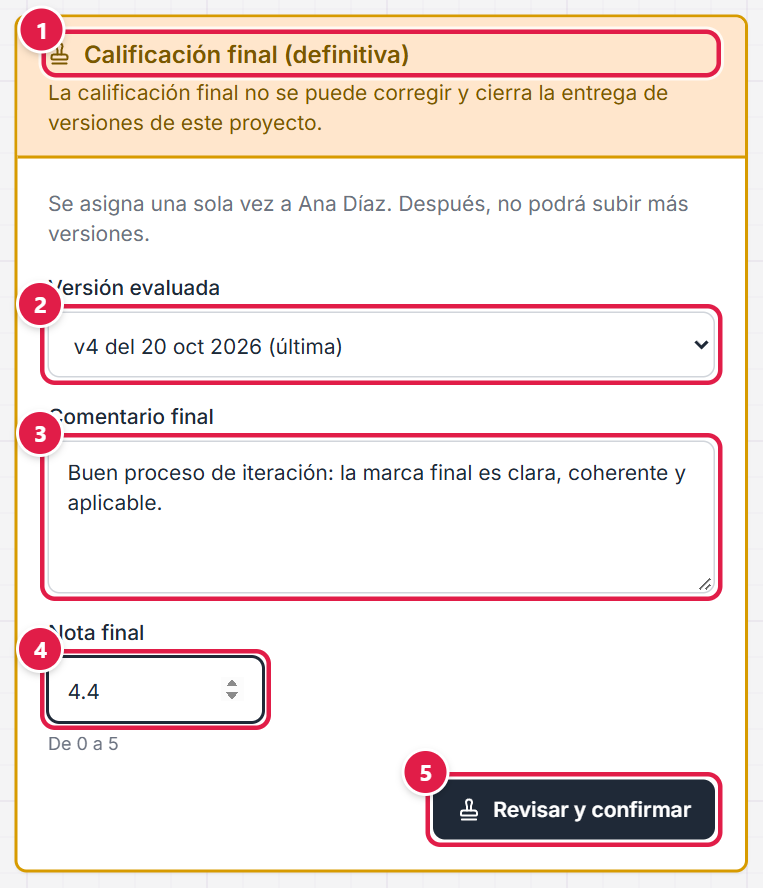

   | # | Elemento | Para qué sirve |
   |---|---|---|
   | 1 | **Calificación final (definitiva)** | El título y el aviso: no se puede corregir y cierra la entrega de versiones |
   | 2 | **Versión evaluada** | Por defecto la última; puedes elegir otra |
   | 3 | **Comentario final** | Obligatorio |
   | 4 | **Nota final** | De 0 a 5, con un decimal (por ejemplo 4.4) |
   | 5 | **Revisar y confirmar** | Abre la confirmación. **Todavía no registra nada** |

4. Haz clic en **Revisar y confirmar** (o, ya con el bloque lleno, en **Asignar calificación
   final** de la barra). Se abre la ventana **Confirmar calificación final**:

   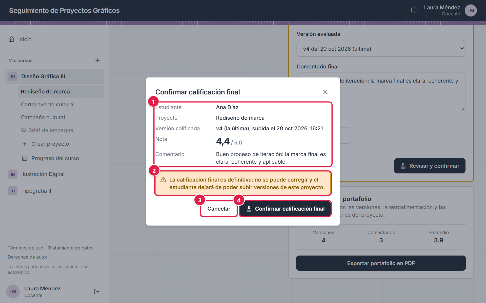

   | # | Elemento | Para qué sirve |
   |---|---|---|
   | 1 | **Resumen** | Estudiante (o grupo), proyecto, versión calificada, nota y comentario. Revísalos |
   | 2 | **Advertencia** | La calificación final es definitiva |
   | 3 | **Cancelar** | Cierra sin registrar nada. Lo que escribiste se conserva. La tecla **Esc** y un clic fuera de la ventana hacen lo mismo |
   | 4 | **Confirmar calificación final** | Registra la calificación. Mientras espera dice «Registrando…» y no se puede volver a pulsar |

5. Al registrarse aparece el aviso **Calificación final registrada** y la barra cambia a
   **Calificación final** con la nota:

   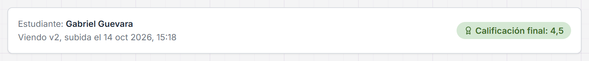

> **Atención:** la calificación final **se asigna una sola vez y no se puede cambiar**. Después,
> ese estudiante **ya no puede subir más versiones** en el proyecto. Calificar a un estudiante no
> bloquea a sus compañeros.

Si la ventana muestra un error, sigue abierta para que reintentes o canceles:

- **No se pudo conectar con el servidor. Intenta de nuevo.** No se registró nada. Revisa la
  conexión y vuelve a pulsar **Confirmar calificación final**.
- **Este estudiante ya tiene una calificación final registrada.** Alguien la registró antes, desde
  otra pestaña o sesión, y no se puede asignar dos veces:

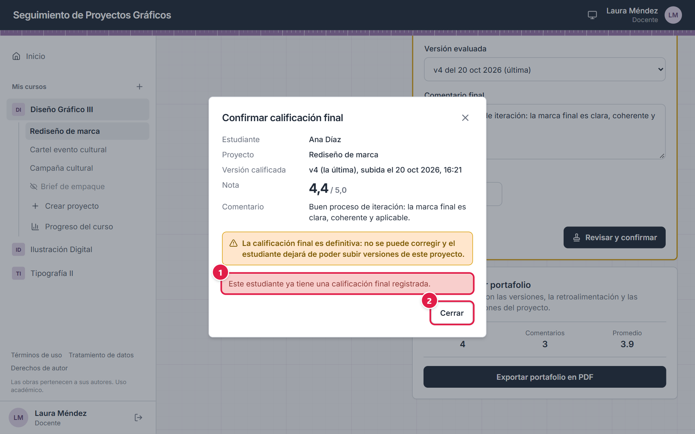

| # | Elemento | Para qué sirve |
|---|---|---|
| 1 | **Mensaje de error** | Explica por qué no se registró la calificación |
| 2 | **Cerrar** | En este caso **Confirmar** desaparece y **Cancelar** pasa a llamarse **Cerrar**. Al cerrar, la barra ya muestra la nota que estaba registrada |

Si el botón de la barra está desactivado, el motivo aparece escrito al lado; por ejemplo, cuando el
estudiante todavía no ha subido versiones.

Cuando ya está asignada, el cierre muestra la nota, el comentario y sobre qué versión se dio:

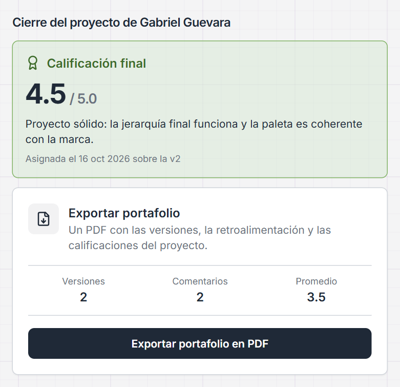

**En proyectos por grupos** depende de cómo creaste el proyecto:

- **Calificación por grupo:** asignas **una sola nota** para todo el grupo, y todos los integrantes
  la reciben a la vez. Después, nadie del grupo puede subir más versiones.
- **Calificación individual:** en el cierre aparece la lista **Integrante**. Eliges a quién
  calificas y le asignas su nota; la barra de arriba muestra a ese integrante. La lista marca con
  «· calificado» a quienes ya tienen nota. Cada integrante calificado deja de subir versiones, pero
  los demás siguen hasta que los califiques.

### 3.10 Gestionar los grupos de un proyecto

En un proyecto por grupos, abre su historial y haz clic en **Grupos del proyecto** (junto al nombre
del proyecto):

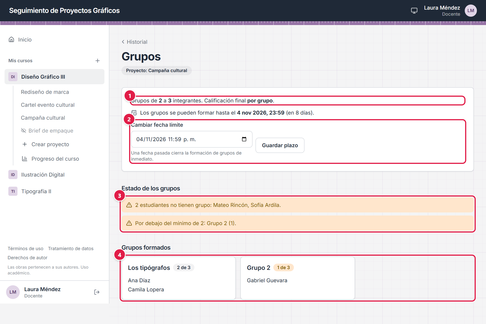

| # | Elemento | Para qué sirve |
|---|---|---|
| 1 | **Configuración** | Tamaño de los grupos y tipo de calificación final. Debajo, hasta cuándo se pueden formar grupos |
| 2 | **Cambiar fecha límite** | Amplía el plazo para los rezagados, o pon una fecha pasada para cerrar la formación de grupos de inmediato. Luego haz clic en **Guardar plazo** |
| 3 | **Estado de los grupos** | Advertencias: estudiantes sin grupo y grupos por debajo del mínimo. Si todo está bien, dice «Todos los estudiantes inscritos tienen grupo» |
| 4 | **Grupos formados** | Cada grupo con sus integrantes y cuántos cupos ocupa |

> Los grupos los forman **los estudiantes**. El docente no puede asignar ni quitar integrantes:
> si alguien se quedó sin grupo, amplía el plazo para que se una a uno.

El historial de un proyecto por grupos tiene un filtro por **Grupo** en lugar de por estudiante.
Cada versión indica el grupo y **quién la subió**:

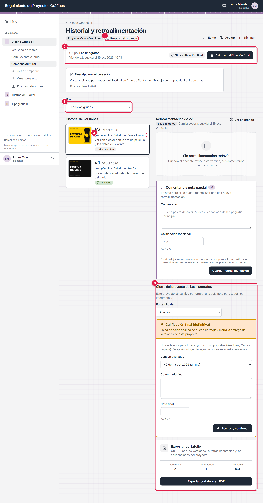

| # | Elemento | Para qué sirve |
|---|---|---|
| 1 | **Grupos del proyecto** | Abre la página de grupos |
| 2 | **Barra de calificación final** | El grupo (o el integrante) que se califica y si ya tiene calificación final |
| 3 | **Grupo** | Filtra el historial de un grupo |
| 4 | **Grupo y autor** | El grupo de la versión y el integrante que la subió |
| 5 | **Cierre del proyecto del grupo** | La calificación final según el modo del proyecto y el portafolio del integrante que elijas en **Portafolio de** |

### 3.11 Ver el progreso del curso

En la barra lateral, dentro del curso, haz clic en **Progreso del curso** (o en **Ver detalle**
desde el panel del curso):

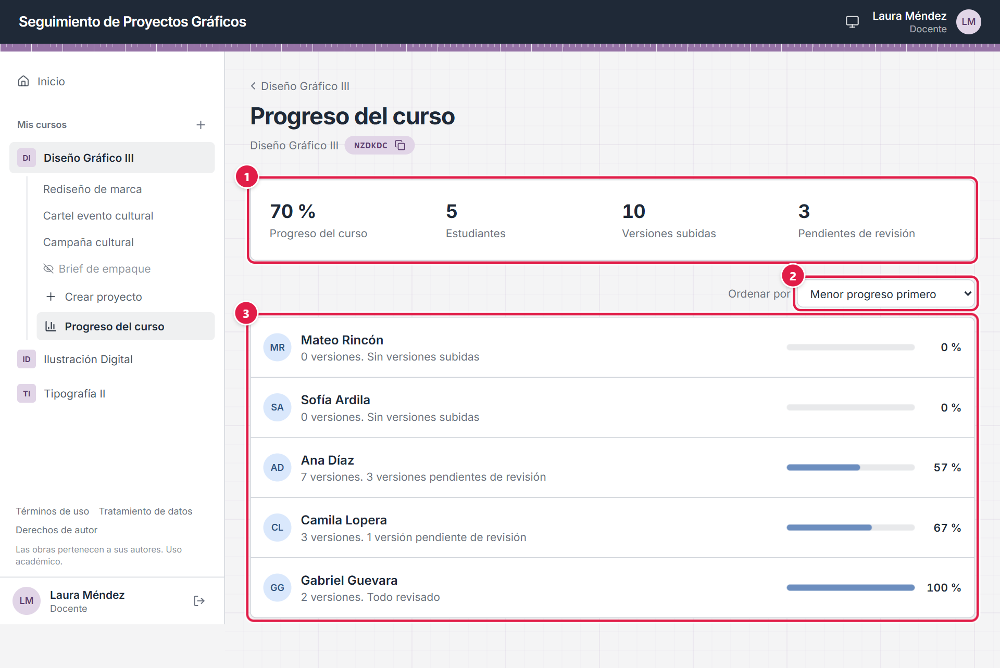

| # | Elemento | Qué muestra |
|---|---|---|
| 1 | **Resumen** | Progreso del curso, número de estudiantes, versiones subidas y versiones pendientes de revisión |
| 2 | **Ordenar por** | Menor progreso primero (para ver quién necesita atención), mayor progreso primero o nombre |
| 3 | **Estudiantes** | El avance de cada estudiante, incluidos los que aún no han subido nada |

**Cómo se calcula el progreso:** es el porcentaje de versiones que ya tienen al menos un
comentario tuyo. Varios comentarios sobre una misma versión cuentan una vez, y la calificación
final también cuenta como comentario. En los proyectos por grupos, cada versión del grupo cuenta
para todos sus integrantes.

### 3.12 Exportar el portafolio de un estudiante

En el **Cierre del proyecto** de cada estudiante (o de cada integrante, en los proyectos por grupos)
está la tarjeta **Exportar portafolio**, con el número de versiones, de comentarios y el promedio de
las notas parciales vigentes. Haz clic en **Exportar portafolio en PDF** y el archivo se descarga
con el nombre `portafolio_<proyecto>_<estudiante>.pdf`.

El PDF tiene una portada con los datos del proyecto, una página por versión con su imagen y su
retroalimentación (las notas reemplazadas aparecen tachadas) y, si existe, la calificación final:

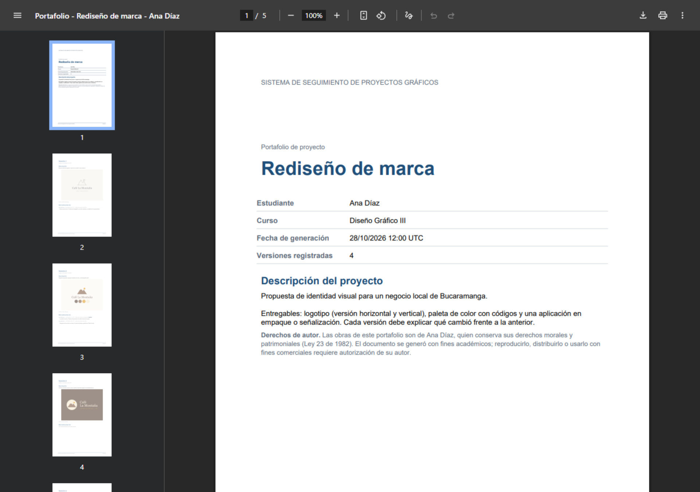

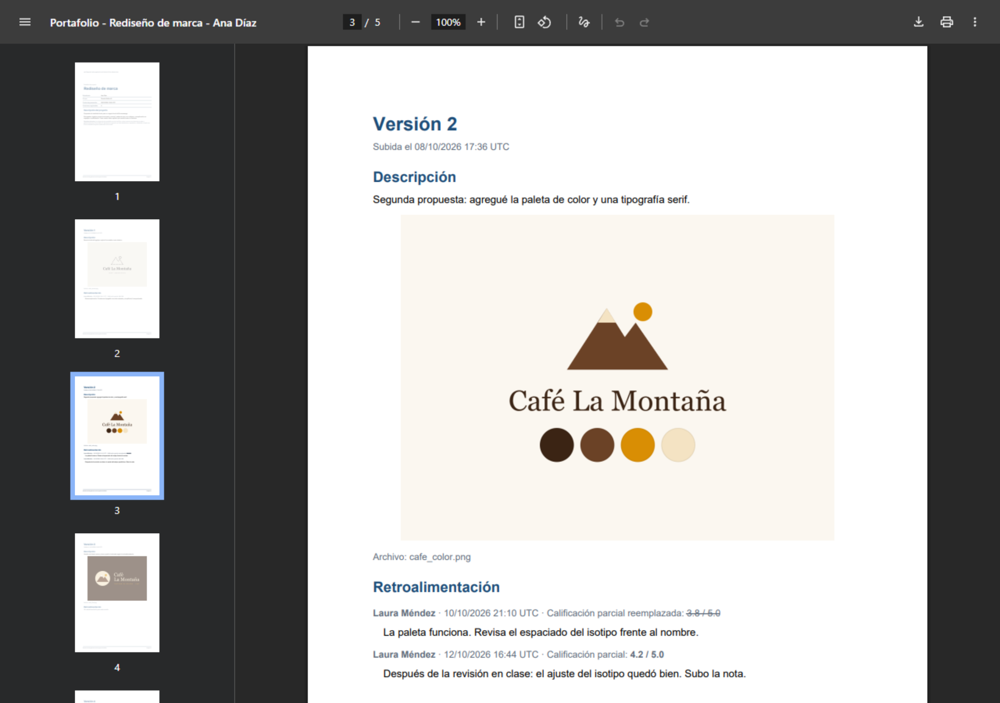

---

## 4. Manual del estudiante

### 4.1 El recorrido completo

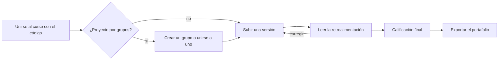

### 4.2 Unirse a un curso

Tu docente te comparte el **código del curso**: seis letras o números.

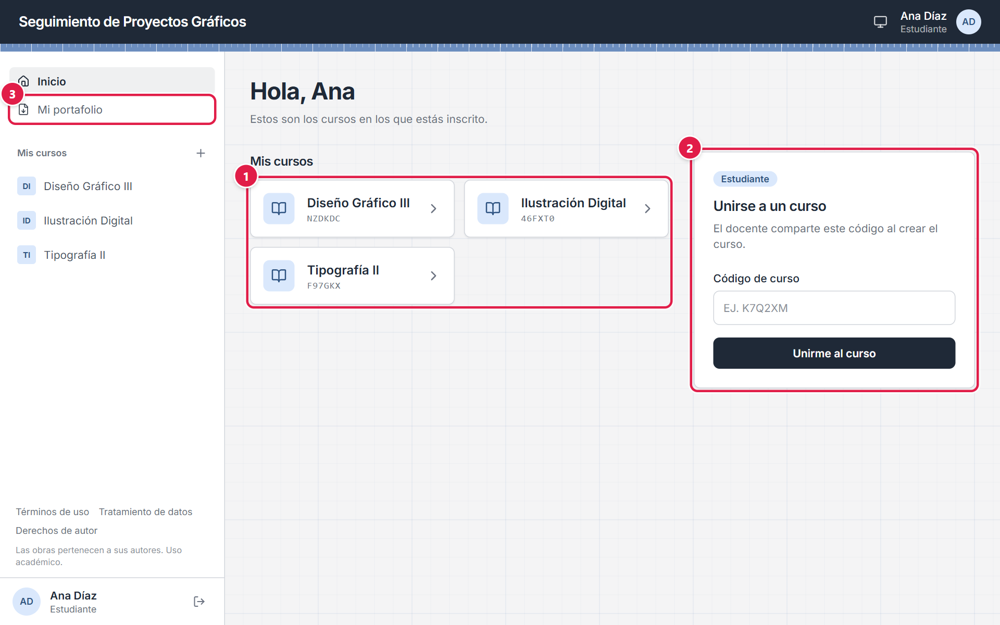

| # | Elemento | Para qué sirve |
|---|---|---|
| 1 | **Mis cursos** | Los cursos en los que estás inscrito |
| 2 | **Unirse a un curso** | El formulario para inscribirte con un código |
| 3 | **Mi portafolio** | Tu portafolio académico en PDF (sección 4.9) |

1. En **Inicio**, escribe el código en **Código de curso**. No importa si usas mayúsculas o
   minúsculas.
2. Haz clic en **Unirme al curso**.

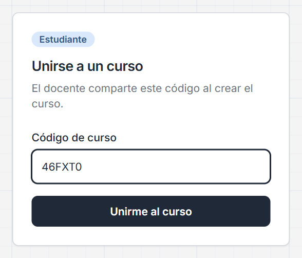

La plataforma abre el curso. Si el docente todavía no ha creado proyectos, lo indica:

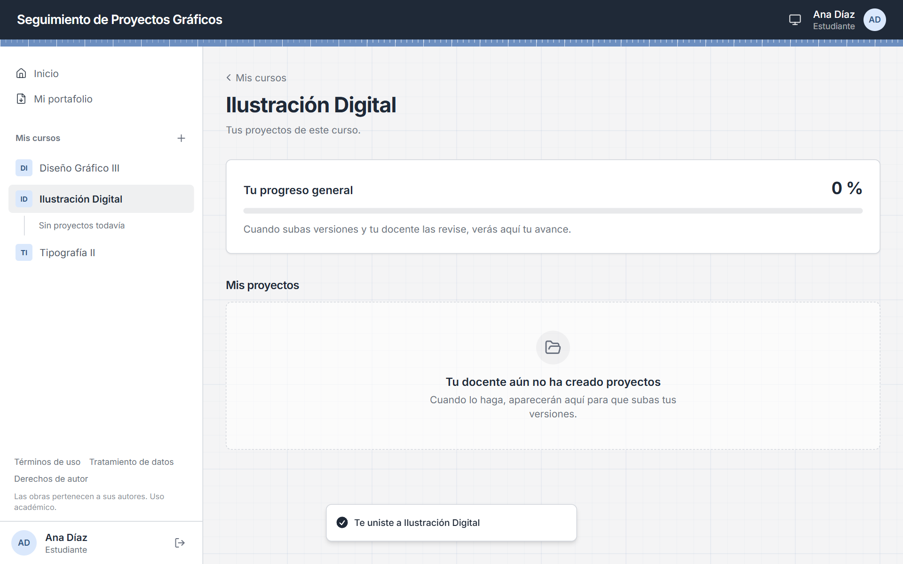

Si el código no existe, verás «Código de curso no válido». Revisa que lo hayas copiado bien (por
ejemplo, la letra O y el número 0).

### 4.3 El panel del curso

Al abrir un curso verás tu progreso y tus proyectos:

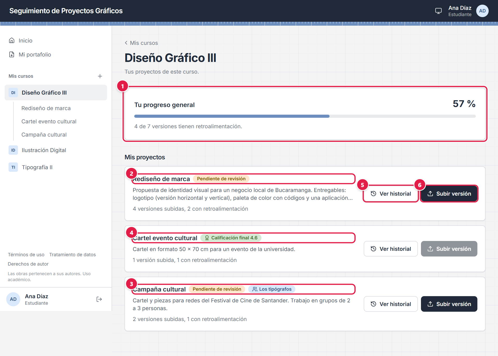

| # | Elemento | Para qué sirve |
|---|---|---|
| 1 | **Tu progreso general** | Qué porcentaje de tus versiones ya revisó el docente |
| 2 | **Proyecto y su estado** | El título y una etiqueta con el estado (tabla siguiente) |
| 3 | **Tu grupo** | En los proyectos por grupos, el nombre de tu grupo |
| 4 | **Calificación final** | Si ya la tienes, aparece la nota |
| 5 | **Ver historial** | Tus versiones y la retroalimentación (sección 4.6) |
| 6 | **Subir versión** | Entregar una versión nueva (sección 4.5). Se desactiva cuando ya tienes calificación final |

Los estados posibles de un proyecto:

| Etiqueta | Qué significa |
|---|---|
| **Sin versiones aún** | Todavía no has subido nada (ni tu grupo) |
| **Sin grupo** | Es un proyecto por grupos y aún no estás en uno. El botón dice **Elegir grupo** |
| **Pendiente de revisión** | Tienes versiones que el docente aún no ha comentado |
| **Retroalimentación recibida** | El docente ya comentó todas tus versiones |
| **Calificación final X** | El proyecto está cerrado con esa nota |

Los proyectos que el docente ocultó no aparecen.

### 4.4 Proyectos por grupos: formar tu grupo

En un proyecto por grupos necesitas estar en un grupo para ver el historial y subir versiones.
Mientras no tengas grupo, el proyecto lo muestra así:

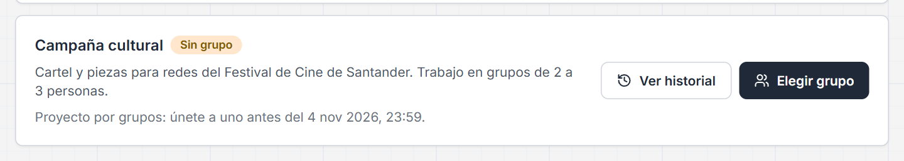

Haz clic en **Elegir grupo**:

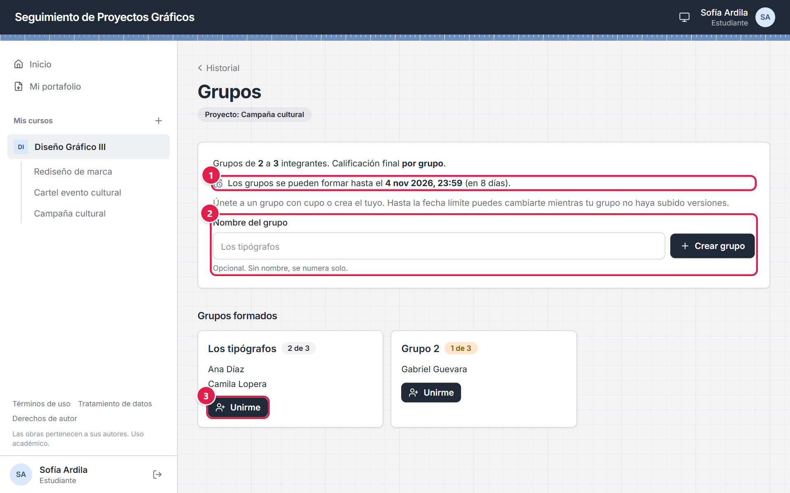

| # | Elemento | Para qué sirve |
|---|---|---|
| 1 | **Plazo** | Hasta cuándo puedes crear un grupo, unirte o salir |
| 2 | **Crear grupo** | Crea un grupo nuevo y te deja como primer integrante. El nombre es opcional: sin nombre se llama «Grupo 1», «Grupo 2», etc. |
| 3 | **Unirme** | Te une a un grupo que tenga cupo. Si está lleno, el botón dice **Grupo completo** |

Reglas de los grupos:

- Solo puedes estar en **un grupo por proyecto**.
- Puedes cambiarte de grupo hasta la fecha límite, **siempre que tu grupo no haya subido
  versiones**. Para cambiarte, primero haz clic en **Salir del grupo**.
- Si el plazo terminó y no alcanzaste a unirte a un grupo, pídele a tu docente que lo amplíe.
- Un grupo que ya tiene calificación final no admite nuevos integrantes.

Cuando ya estás en un grupo, la página lo marca como **Tu grupo** (1) y tiene un acceso al
historial del grupo (2):

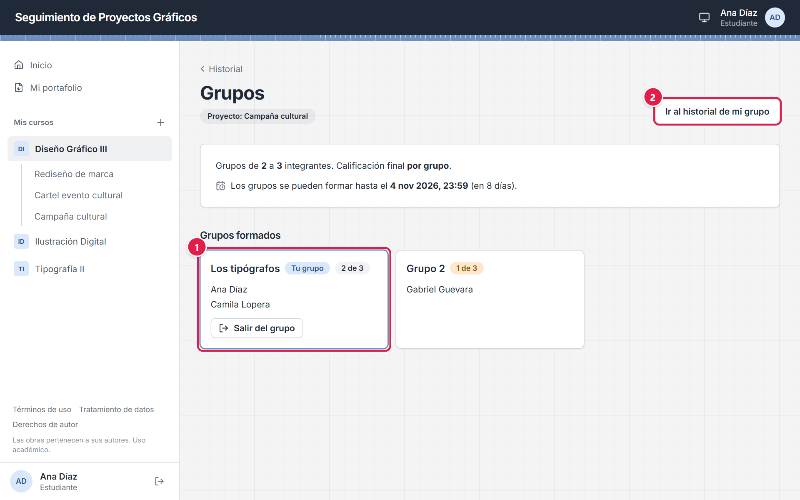

### 4.5 Subir una versión

1. En el panel del curso, haz clic en **Subir versión** en el proyecto.
2. Completa el formulario:

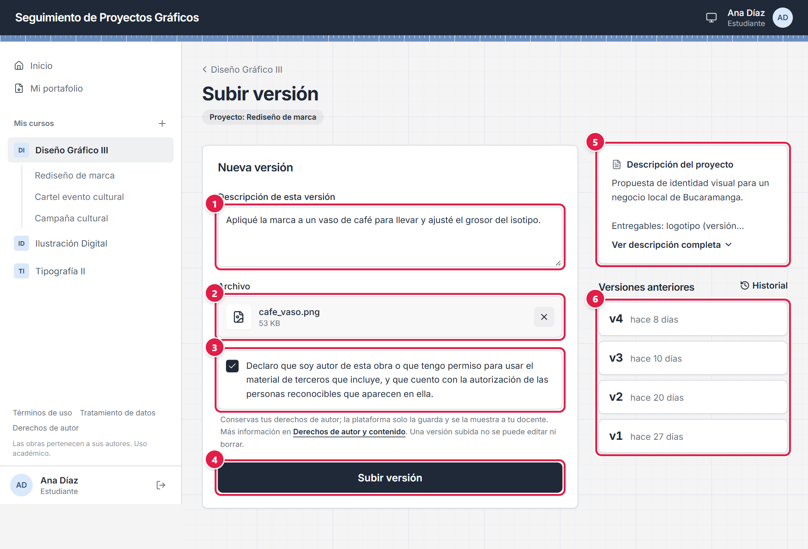

| # | Elemento | Qué hacer |
|---|---|---|
| 1 | **Descripción de esta versión** | Explica qué cambiaste frente a la versión anterior (obligatoria, hasta 2000 caracteres). Le ayuda al docente a revisar |
| 2 | **Archivo** | Arrastra el archivo o haz clic para elegirlo. Formatos: **JPG, PNG, PDF o SVG**, hasta **20 MB**. Con la **X** lo quitas para elegir otro |
| 3 | **Declaración de autoría** | Marca la casilla para declarar que eres autor de la obra, que tienes permiso para usar el material de terceros que incluye y que cuentas con la autorización de las personas reconocibles que aparecen. Es obligatoria. Tú conservas tus derechos de autor |
| 4 | **Subir versión** | Envía la versión. Mientras se sube, el botón dice «Subiendo…» |
| 5 | **Descripción del proyecto** | El enunciado del docente, para tenerlo a la vista. **Ver descripción completa** lo despliega |
| 6 | **Versiones anteriores** | Tus versiones ya subidas. Clic en una para verla en el historial |

Al terminar, la plataforma muestra «Versión subida» y abre el historial con tu versión nueva
seleccionada:

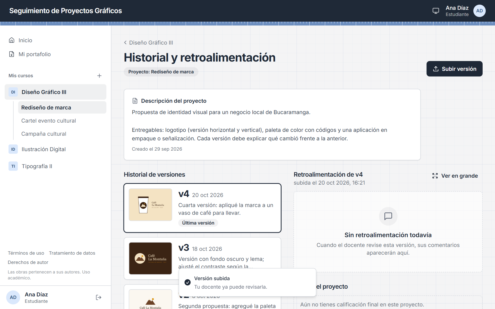

> **Una versión subida no se puede editar ni borrar.** Si te equivocaste de archivo, sube una
> versión nueva y explícalo en la descripción.

Si el archivo no cumple las condiciones, el formulario lo indica junto al archivo:

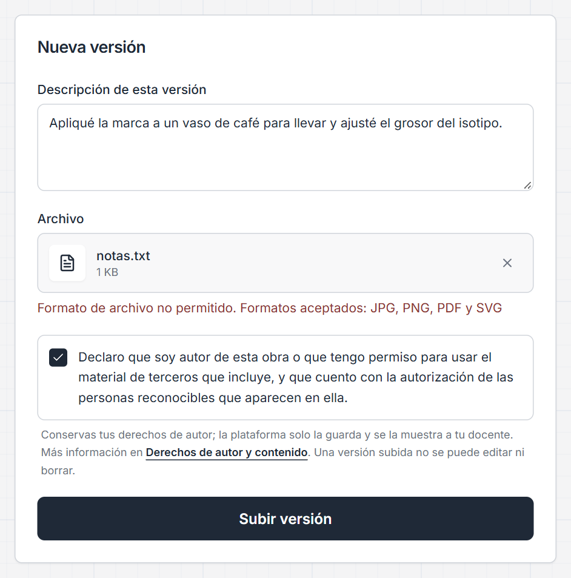

### 4.6 Ver el historial y la retroalimentación

Abre el proyecto desde **Ver historial** o desde la barra lateral:

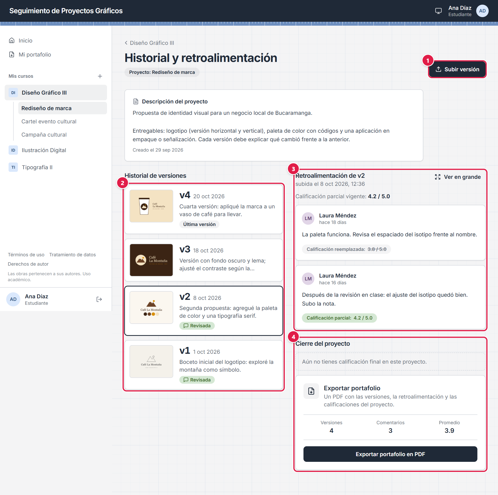

| # | Elemento | Para qué sirve |
|---|---|---|
| 1 | **Subir versión** | Entregar otra versión |
| 2 | **Historial de versiones** | Tus versiones, de la más reciente a la más antigua. **Revisada** indica que el docente ya la comentó. Haz clic en una para ver sus comentarios |
| 3 | **Retroalimentación** | Los comentarios del docente sobre la versión elegida, con la calificación parcial vigente. Si el docente cambió la nota, la anterior aparece tachada como **Calificación reemplazada**. **Ver en grande** muestra el archivo en tamaño completo |
| 4 | **Cierre del proyecto** | Tu calificación final (cuando exista) y la exportación del portafolio del proyecto |

En un **proyecto por grupos** el historial es el de tu grupo: ves las versiones de todos los
integrantes, con quién subió cada una (2), y la retroalimentación es visible para todo el grupo. El
enlace con el nombre del grupo (1) abre la página de grupos:

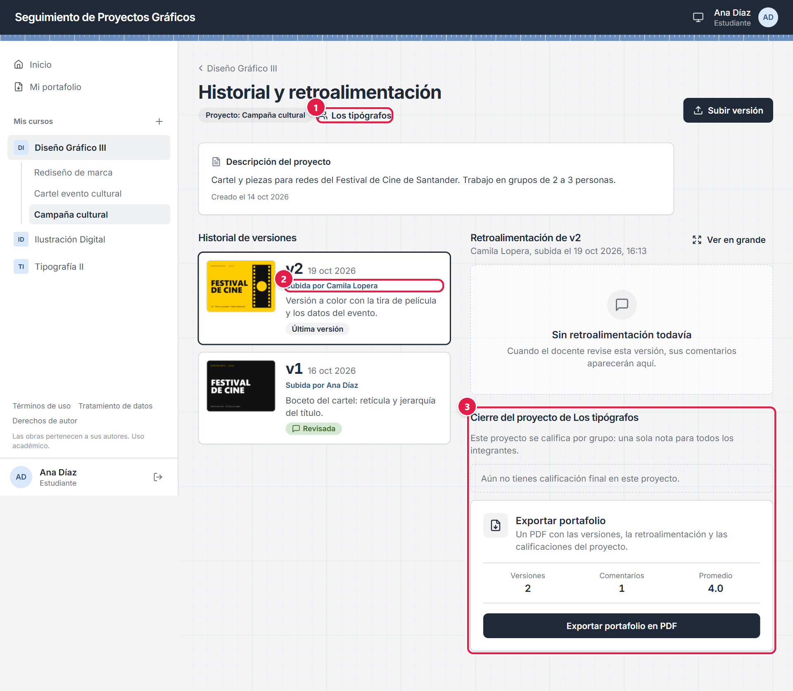

### 4.7 Calificación final

Cuando el docente asigna tu calificación final, la ves en el **Cierre del proyecto** y en el panel
del curso:

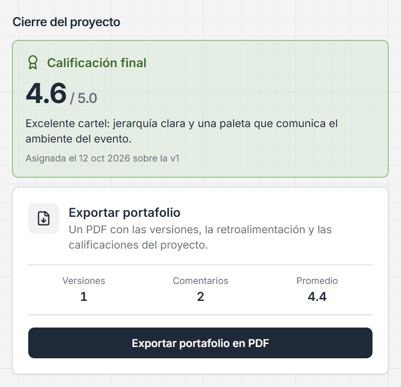

Desde ese momento **ya no puedes subir más versiones** en ese proyecto, pero puedes seguir viendo
el historial y exportar el portafolio. En los proyectos con calificación por grupo, la nota es la
misma para todos los integrantes.

### 4.8 Exportar el portafolio de un proyecto

En el **Cierre del proyecto** de cualquier proyecto, haz clic en **Exportar portafolio en PDF**. El
archivo se descarga con el nombre `portafolio_<proyecto>_<tu-nombre>.pdf` e incluye tus versiones,
la retroalimentación y tu calificación final (sección 3.12 muestra cómo se ve). Si el proyecto no
tiene versiones, el PDF dice que no hay evidencias registradas.

### 4.9 Armar tu portafolio académico

**Mi portafolio**, en la barra lateral, arma un solo PDF con proyectos de uno o varios cursos:

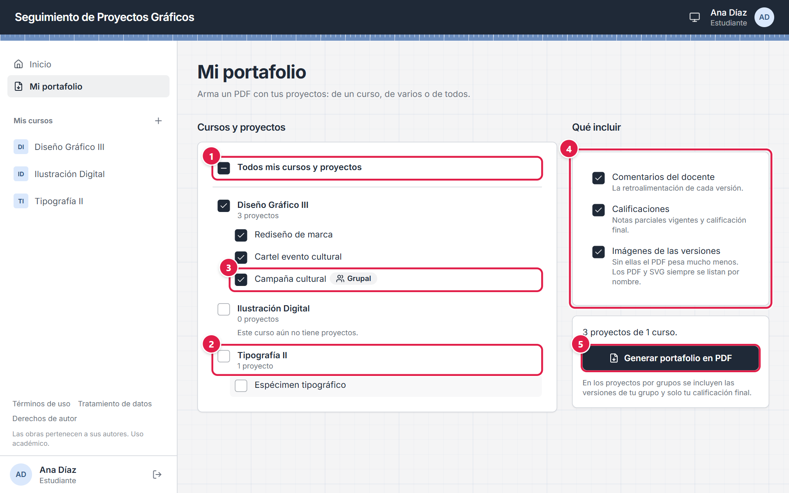

| # | Elemento | Para qué sirve |
|---|---|---|
| 1 | **Todos mis cursos y proyectos** | Marca o desmarca todo. Un guion (–) indica que hay una selección parcial |
| 2 | **Curso** | Marca o desmarca todos los proyectos de ese curso |
| 3 | **Proyecto** | Elige proyectos uno por uno. **Grupal** marca los proyectos por grupos |
| 4 | **Qué incluir** | **Comentarios del docente**, **Calificaciones** (parciales vigentes y final) e **Imágenes de las versiones**. Sin imágenes, el PDF pesa mucho menos y cada archivo se lista por su nombre |
| 5 | **Generar portafolio en PDF** | Descarga `portafolio_academico_<tu-nombre>.pdf`. Encima se resume cuántos proyectos y cursos elegiste |

En los proyectos por grupos se incluyen las versiones de tu grupo y **solo tu** calificación final.
Los archivos PDF y SVG que hayas subido siempre se listan por nombre, sin vista previa.

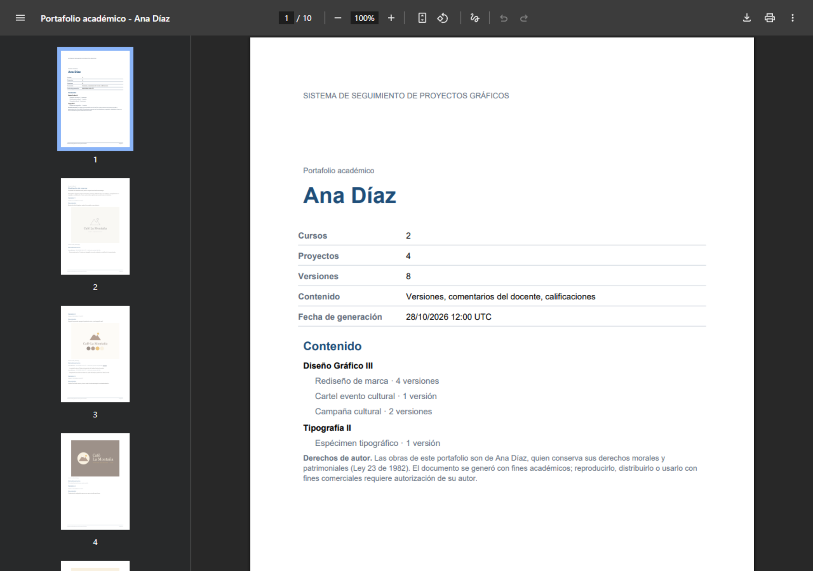

---

## 5. Preguntas frecuentes

**Olvidé mi contraseña. ¿Cómo la recupero?**
La plataforma todavía no tiene recuperación de contraseña. Pide ayuda al administrador de la
plataforma en tu institución.

**Me registré con el rol equivocado. ¿Puedo cambiarlo?**
No. El rol queda fijo al crear la cuenta. Tendrás que crear otra cuenta con otro correo. Puedes
pedir que se eliminen los datos de la cuenta anterior escribiendo a `datos@udi.edu.co`.

**¿Recibo correos o notificaciones cuando hay comentarios nuevos?**
No. Revisa tu panel: los estados **Pendiente de revisión** y **Retroalimentación recibida**, y la
etiqueta **Revisada** en el historial, te dicen qué hay nuevo.

**Un proyecto desapareció de mi curso.** *(estudiante)*
El docente lo ocultó. Tus versiones no se perdieron: vuelven a aparecer cuando lo muestre de nuevo.

**¿Puedo salirme de un curso?**
No por ahora. Los cursos en los que te inscribiste siguen en tu lista.

**¿Puedo borrar o reemplazar una versión que subí por error?**
No: las versiones son el registro del proceso y no se modifican. Sube una versión nueva y explica
en la descripción que corrige la anterior.

**¿Puedo editar un comentario o una calificación final?** *(docente)*
No. Para aclarar un comentario, agrega otro. Una calificación parcial se reemplaza escribiendo una
nueva. La calificación final no se puede cambiar: revísala bien antes de confirmarla.

**Escribí una nota parcial creyendo que era la final.** *(docente)*
No pasa nada: la nota parcial se reemplaza con otra retroalimentación. La final se asigna aparte,
en el bloque naranja **Calificación final (definitiva)** o con el botón **Asignar calificación
final** de la barra de arriba, y siempre pide confirmación (sección 3.9).

**¿Cómo sé si un estudiante ya tiene calificación final?** *(docente)*
Mira la barra de arriba del historial: dice **Sin calificación final** o **Calificación final** con
la nota.

**¿Por qué no puedo cambiar la modalidad o el tamaño de los grupos?** *(docente)*
Porque el proyecto ya tiene grupos o versiones, y cambiar esas reglas afectaría el trabajo que ya
hicieron los estudiantes. El título, la descripción, la visibilidad y la fecha límite sí se pueden
cambiar.

**Un estudiante quedó sin grupo y el plazo ya pasó.** *(docente)*
Abre **Grupos del proyecto**, pon una fecha límite nueva en **Cambiar fecha límite** y haz clic en
**Guardar plazo**. El estudiante ya podrá unirse a un grupo.

**¿Puedo usar la plataforma en el celular?**
Sí. Todo funciona igual; el menú se abre con el botón ☰ (sección 2.5).

**El PDF no se descargó.**
Revisa si el navegador bloqueó la descarga (suele avisar en la barra de direcciones) y la carpeta
de descargas. Un portafolio con muchas imágenes puede tardar unos segundos: el botón dice
«Generando PDF…» mientras tanto.

---

## 6. Mensajes del sistema y qué hacer

| Mensaje | Por qué aparece | Qué hacer |
|---|---|---|
| Credenciales inválidas | El correo o la contraseña no coinciden | Revisa que el correo sea el institucional y la contraseña, incluidas mayúsculas |
| El correo ya está registrado | Ya existe una cuenta con ese correo | Inicia sesión con él |
| Elige si te registras como estudiante o como docente | No elegiste el rol al registrarte | Haz clic en una de las dos tarjetas |
| Para crear la cuenta debes aceptar los términos y autorizar el tratamiento de tus datos | No marcaste la casilla de autorización | Márcala para continuar |
| *(sin mensaje)* La plataforma te devuelve al inicio de sesión | Pasaron 60 minutos y la sesión venció | Inicia sesión otra vez: regresarás a la página donde estabas |
| No se pudo conectar con el servidor. Intenta de nuevo. | Sin conexión a internet, o el servidor está despertando | Revisa tu conexión y espera unos segundos |
| Código de curso no válido | El código no existe | Pídele el código correcto al docente |
| No tienes acceso a este curso. | No estás inscrito en ese curso | Únete con el código desde Inicio |
| Formato de archivo no permitido. Formatos aceptados: JPG, PNG, PDF y SVG | El archivo es de otro tipo (por ejemplo, .psd, .ai o .docx) | Expórtalo a JPG, PNG, PDF o SVG |
| El archivo supera el tamaño máximo permitido de 20 MB | El archivo pesa más de 20 MB | Reduce la resolución o comprime el PDF |
| El contenido del archivo no corresponde a su formato | Se cambió la extensión del archivo sin convertirlo | Expórtalo de nuevo desde el programa de diseño |
| Para subir la versión debes confirmar esta declaración | No marcaste la declaración de autoría | Márcala |
| Este proyecto es por grupos: únete a un grupo para subir versiones | Aún no tienes grupo | Haz clic en **Elegir grupo** |
| El plazo para formar grupos terminó | Pasó la fecha límite | Pide al docente que la amplíe |
| Ya perteneces a un grupo de este proyecto | Intentaste crear un grupo o unirte a otro | Sal primero de tu grupo, si aún no ha subido versiones |
| El grupo está completo | El grupo llegó al máximo de integrantes | Únete a otro grupo o crea uno |
| El grupo ya subió versiones: no puedes salir de él | Tu grupo ya entregó trabajo | Sigue en ese grupo; si hay un problema, habla con el docente |
| El grupo ya tiene calificación final: no admite cambios | El grupo ya fue calificado | Únete a otro grupo |
| Ya tienes calificación final en este proyecto: no se aceptan más versiones | El docente ya cerró tu proyecto | Nada: el proyecto está terminado |
| La modalidad, el tamaño de los grupos y la calificación ya no se pueden cambiar… | El proyecto ya tiene grupos o versiones | Cambia solo el título, la descripción, la visibilidad o la fecha límite |
| El proyecto tiene versiones: ocúltalo en lugar de eliminarlo | Intentaste eliminar un proyecto con entregas | Usa **Ocultar** |
| La fecha límite para formar grupos debe ser futura | Al crear el proyecto pusiste una fecha pasada | Elige una fecha posterior a hoy |
| La calificación de esta versión cambió mientras guardabas… | Otra persona u otra pestaña guardó una nota al mismo tiempo | Recarga la página, revisa la nota vigente y vuelve a intentar |
| Este estudiante ya tiene una calificación final registrada. *(o «Este grupo…»)* | Se asignó antes, desde otra pestaña o sesión | Cierra la ventana: la barra ya muestra la nota. No se puede asignar dos veces |
| Este estudiante aún no ha subido versiones: no hay nada que calificar. | El estudiante (o el grupo) no tiene versiones; aparece junto al botón **Asignar calificación final** desactivado | Espera a que entregue |
| No se pudo consultar la calificación final. | Falló la consulta del estado de la calificación | Haz clic en **Reintentar**, junto al mensaje |

---

## 7. Resumen: lo que se puede y lo que no se puede deshacer

| Acción | ¿Se puede deshacer o cambiar? |
|---|---|
| Elegir el rol al registrarse | **No** |
| Unirse a un curso | **No** (no hay opción para salir) |
| Subir una versión | **No**: no se edita ni se borra |
| Comentario del docente | **No**: no se edita ni se borra; se puede agregar otro |
| Calificación parcial | **Sí**: una nota nueva reemplaza a la vigente (la anterior queda tachada) |
| Calificación final | **No** |
| Ocultar un proyecto | **Sí**: con **Mostrar** vuelve todo como estaba |
| Eliminar un proyecto sin versiones | **No** |
| Modalidad, tamaño de grupos y tipo de calificación | **Sí**, solo mientras el proyecto no tenga grupos ni versiones |
| Título, descripción, visibilidad y fecha límite de un proyecto | **Sí**, siempre |
| Entrar a un grupo | **Sí**: se puede salir hasta la fecha límite, si el grupo no ha subido versiones |
